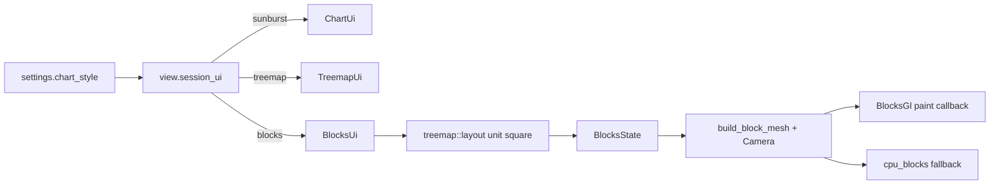

# Resume 3D Blocks ChartStyle

## Current state

Opus left a staged WIP (865 lines) that adds a third chart style `"blocks"` ("file city"):

- New: [`src/ui/blocks.rs`](src/ui/blocks.rs) — treemap footprint → height-from-size, CPU perspective projection, `BlocksGl` shader, `blocks_ui`
- Partial wiring: [`src/ui/mod.rs`](src/ui/mod.rs), [`src/ui/view.rs`](src/ui/view.rs) dispatch, [`src/ui/modals.rs`](src/ui/modals.rs) third button, [`src/ui/app.rs`](src/ui/app.rs) field declarations only

It does **not** compile today.

## Compile blockers in `blocks.rs`

1. Remove invalid Python-skill leftovers: seven `## END for ...` lines (e.g. after the layout loop ~153, `step` ~248, mesh loops ~629–635, `cpu_blocks` ~658–663).
2. Fix sort comparator: `Ordering::equal` → `Ordering::Equal` in `build_block_mesh`.
3. Drop unused imports that will warn/fail under `-D warnings` if enabled: `group_key`, `view_children`, `FREE_KEY`, `Tile`, `node_label`, `bold`, `cr`, `BtnStyle`, `Icon`, `fmt_count`, `fmt_size`, `NONE` (keep what `blocks_ui` / labels actually use after polish).

## Finish App / Session wiring in [`src/ui/app.rs`](src/ui/app.rs)

Mirrored after sunburst GL + vertex buffers:

- `Session::new`: initialize `blocks: Default::default()`.
- Add `block_verts: Vec<f32>` and `block_idx: Vec<u32>` on `Session` (already used in `blocks_ui`); init empty like `verts`/`idx`.
- Add `blocks_gl: Option<Arc<Mutex<BlocksGl>>>` on `App`.
- In `App::new`, create `BlocksGl` from `cc.gl` the same way as `SunburstGl` (independent; if it fails, leave `None` and rely on CPU fallback).
- In `on_exit`, destroy `blocks_gl` like `gl`.
- Repaint settle check (~1063): treat `"blocks"` like treemap — `!s.blocks.settled`.

## Integration parity

- [`src/ui/view.rs`](src/ui/view.rs) `panel_ui` (~537/598): when `chart_style == "blocks"`, use `s.blocks.color_of(...)` (not sunburst anim).
- [`src/ui/director.rs`](src/ui/director.rs) `aim_pos`: for `"blocks"`, resolve node path then `s.blocks.center_of(...)`. Change `BlocksState::center_of` to take a viewport `Rect` and build `Camera` internally (keep `Camera` private).
- [`src/settings.rs`](src/settings.rs): doc comment → `"sunburst" | "treemap" | "blocks"`.
- [`src/ui/modals.rs`](src/ui/modals.rs): update helper caption to mention 3D blocks; keep the three-button layout Opus already adjusted.

## Small correctness / UX fixes in `blocks_ui`

- Draw the ground plane **before** enqueueing the GL/CPU mesh so blocks sit on top of the floor.
- Add a compact hover label (name + size) at the projected top-center of the hovered block — same strings as treemap/sunburst (`node_label` / group / free), without per-block text on every face.
- Leave camera fixed (no orbit UI) for this pass; performance caps already present (`MAX_BLOCKS`, throttled layout while scanning).

## Verify

- `cargo check` (or `cargo build`) until clean.
- Manual: Settings → **3D Blocks**, navigate/click/drag/delete, CPU path if GL init fails (`SQUIRRELDISK_CHART=blocks` for quick start).
